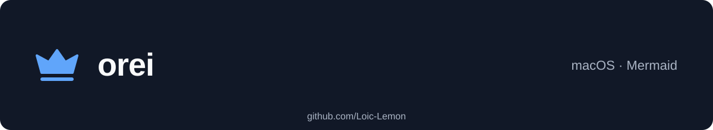
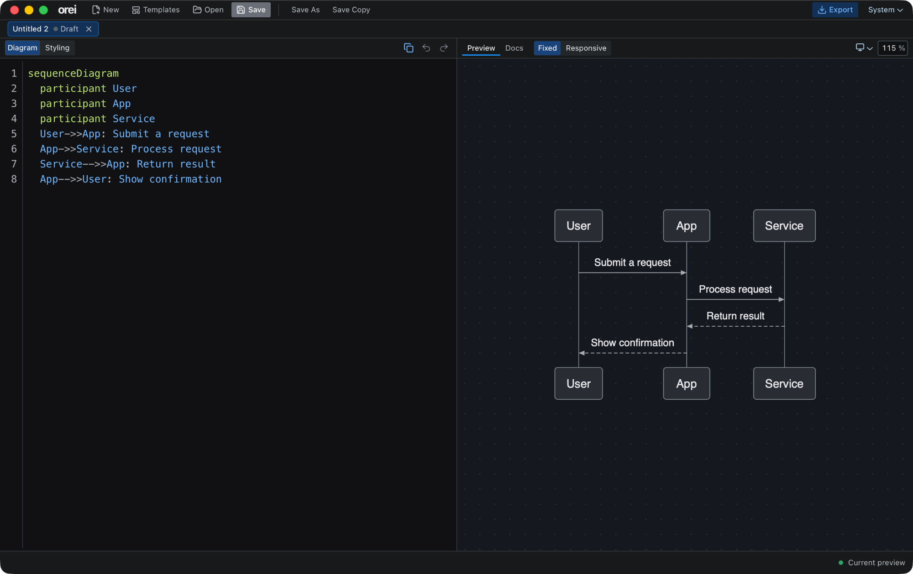

# orei

A macOS editor for Mermaid diagrams powered by [Pele](https://pele.run/).



## Features

- Edit Mermaid and CSS offline with a live preview.
- Work in tabs with autosave and draft recovery.
- Save diagrams as Markdown notes or as Mermaid and CSS files.
- Use built-in Lucide icons and import SVG icons, Iconify packs, or local PNGs.
- Export SVG or PNG, or copy the PNG image or SVG markup.

## Build on macOS

Requires Node.js 24 with npm, Rust, and Xcode Command Line Tools (`xcode-select --install`).

Run the commands below from the repo root.

```sh
npm ci
npm run release
```

Then open the built app.

```sh
open src-tauri/target/release/bundle/macos/orei.app
```

### Install in Applications

To keep the app in Applications, copy the built app and open the installed copy.

```sh
ditto src-tauri/target/release/bundle/macos/orei.app /Applications/orei.app
open /Applications/orei.app
```

You can then find **orei** in Finder or Spotlight.

## License

[MIT License](LICENSE) · [Third-party notices](THIRD_PARTY_NOTICES.md)
